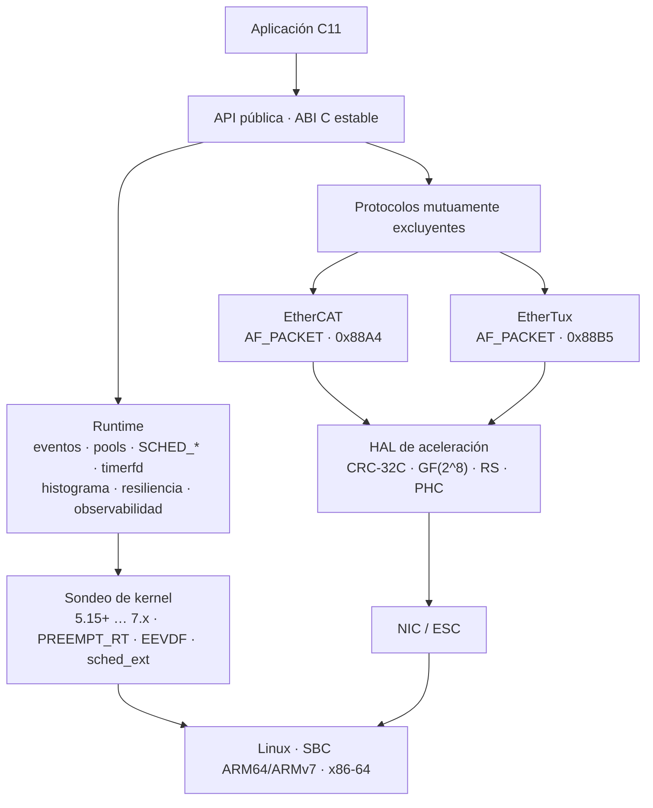

# ChronosRT Master

**Capa de tiempo real determinista para control industrial sobre SBC y x86-64.**

[](#estado-del-proyecto)
[](#estado-del-proyecto)
[](#requisitos)
[](#requisitos)
[](#tests)
[](#licencia)

ChronosRT Master es una biblioteca C11 (`libchronosrt.so`, ABI `0x000100`) que
convierte una placa ARM64, ARMv7 o x86-64 con Linux en un nodo de comunicación
**determinista**: planifica los ciclos con cotas acotadas, envía tramas con
*pacing* por hardware, protege el tráfico crítico frente a la congestión y
recupera paquetes perdidos sin retransmitir.

Su uso típico es el enlace de tiempo real entre un controlador (CNC, PLC, robot,
célula de fabricación) y sus esclavas o nodos periféricos. **No es un kernel ni
sustituye a PREEMPT_RT**: es la capa de usuario que explota un kernel RT ya
ajustado y que **degrada de forma controlada** cuando falta aceleración por
hardware o el kernel no está preparado.

- **EtherCAT autónomo** (`AF_PACKET`, `0x88A4`): sin SOEM, IgH ni DPDK.
- **EtherTux v0.1.0** (`AF_PACKET`, `0x88B5`): Ethernet comercial determinista.
- **ID local determinista**: MAC LAA derivada del ID, filtro de recepción O(1) y
  admisión con autoridad central (sin *flooding* del switch).
- **10 suites / 547 aserciones** · **321 símbolos `ChronosRT_*`** · build `Release` sin warnings.

---

## Índice

- [Qué es ChronosRT Master](#qué-es-chronosrt-master)
- [Estado del proyecto](#estado-del-proyecto)
- [Inicio rápido](#inicio-rápido)
- [Características](#características)
- [Arquitectura](#arquitectura)
- [Protocolos de red](#protocolos-de-red)
- [Rendimiento medido](#rendimiento-medido)
- [HAL de aceleración](#hal-de-aceleración)
- [Plataformas soportadas](#plataformas-soportadas)
- [Requisitos](#requisitos)
- [Construcción](#construcción)
- [Tests](#tests)
- [Benchmark](#benchmark)
- [Ejemplo mínimo](#ejemplo-mínimo)
- [Integración con TuxRT](#integración-con-tuxrt)
- [Seguridad](#seguridad)
- [Checklist de tiempo real](#checklist-de-tiempo-real)
- [Documentación](#documentación)
- [Contribuir](#contribuir)
- [Licencia](#licencia)

---

## Qué es ChronosRT Master

| Necesidad | Qué aporta |
| --- | --- |
| Ciclos de control con jitter bajo y acotado | `SCHED_DEADLINE`/`SCHED_FIFO`, afinidad a núcleos aislados, *tick* por `timerfd` e histograma de latencias con **WCET**. |
| Comunicación con esclavas EtherCAT | Maestro autónomo sobre `AF_PACKET`/`0x88A4`: escaneo, FMMU/SM, *process data*, DC (`sync0`/`sync01`), CoE/SDO y redundancia de doble NIC. |
| Determinismo sin hardware EtherCAT | **EtherTux** sobre Ethernet comercial (`0x88B5`): superframe de 1 ms, ventanas dedicadas, QoS P0–P5, *backpressure*, LAPM, FEC y *heartbeat*. |
| Recuperar pérdidas sin retransmitir | FEC Reed-Solomon RS(10,8)/RS(16,8) sobre GF(2^8) con decodificación de borrados. |
| Validar la plataforma | `ChronosRT_kernel_probe()`: PREEMPT_RT, `isolcpus`, `nohz_full`, `rcu_nocbs`, EEVDF, `sched_ext`, `io_uring`, AF_XDP, `SCHED_DEADLINE` y `memfd_secret`, con nivel de soporte 0–3. |
| Medir y demostrar rendimiento | Benchmark integrado (latencia, throughput, jitter, estrés, WCET, `frame`, `crc`) y contadores/traza. |
| Sobrevivir a un fallo | Snapshot A/B, WAL con reproducción y *Golden Image* con CRC. |
| Integrarse con el ecosistema TuxRT | Se publica como **proveedor** (`tuxrt_provider_descriptor`) descubierto por `libtuxrt_core` vía `dlopen`; nunca enlaza contra él. |

### Qué no hace

- No implementa el planificador de movimiento, la cinemática ni el parser de
  G-code: eso vive en `libtuxrt_core`.
- No configura el kernel por ti: detecta y valida; el ajuste
  (`isolcpus`, `nohz_full`, `rcu_nocbs`, *governor*) lo aplica el operador.
- No implementa cifrado ni autenticación (véase [Seguridad](#seguridad)).
- No usa motores criptográficos del SoC en el camino crítico: solo los reporta
  como capacidad para el plano de gestión.

---

## Estado del proyecto

Datos verificados en el host de referencia (**AMD Ryzen 7 4800H**, Linux
`7.3.0-2-cachyos-rt-bore` con **PREEMPT_RT**, GCC `16.2.1`, CMake `4.4.4`,
build `Release`, *governor* **`performance`**, **núcleos 2–3 aislados** con
`isolcpus=2,3 nohz_full=2,3 rcu_nocbs=2,3 irqaffinity=0-1`):

| Comprobación | Resultado |
| --- | --- |
| Compilación | **0 errores, 0 warnings** |
| `ctest` | **10/10 suites**, **547 aserciones** |
| Símbolos exportados | **321 `ChronosRT_*`** con visibilidad controlada |
| HAL detectada | `crc32c_backend = "sse4.2-x4"`, `fec_backend = "avx2"` |
| Benchmark | `--mode frame`, `crc`, `aalid`, `latency`, `jitter`, `wcet` y `throughput`; eleva a `SCHED_FIFO`, calienta y publica p50/p99/p99.9 + picos > 10 µs |
| Versión / ABI | `0.1.0` / `0x000100` · SONAME `libchronosrt.so.0` |

> Los objetivos de latencia (< 10 µs), jitter (σ < 1 µs) y throughput
> (> 10 M eventos/s) dependen del kernel y del aislamiento de CPU. En la campaña
> con los núcleos **2–3 aislados** y *governor* `performance` sobre
> `7.3.0-2-cachyos-rt-bore` (mediana de 5 repeticiones) se midieron
> **latencia 23 ns**, **σ 51 ns**, **p99.9 50 ns**, **WCET 16,9 µs** con
> **1,9–4,1 picos > 10 µs por millón** y **46,3 M eventos/s** (1P+1C)
> (detalle en [Rendimiento medido](#rendimiento-medido)).
> Las cifras de red deben validarse en cada plataforma con `chronosrt_bench`,
> `rtla` y `cyclictest`.

---

## Inicio rápido

```bash
git clone https://github.com/LauOtero/ChronosRT_MASTER.git
cd ChronosRT_MASTER

cmake -S . -B build -DCMAKE_BUILD_TYPE=Release
cmake --build build -j"$(nproc)"
ctest --test-dir build --output-on-failure

# Coste de CPU por trama y capacidad de la HAL (núcleo aislado 2)
taskset -c 2 ./build/chronosrt_bench --mode frame
taskset -c 2 ./build/chronosrt_bench --mode crc --duration 1
```

Salida esperada (extracto real con `taskset -c 2` sobre `7.3.0-2-cachyos-rt-bore`):

```text
[chronosrt] Kernel: 7.3.0 (7.3.0-2-cachyos-rt-bore)
[chronosrt] PREEMPT_RT: sí
[chronosrt] aislamiento: isolcpus=on nohz_full=on rcu_nocbs=on

EtherCAT (datagrama de 10 B + datos):
  construir datagrama (1024 B)   22.10 ns
  parsear datagrama (1024 B)      4.93 ns

EtherTux v0.1.0 (cabecera de 26 B):
  construir PDU (1464 B, con copia)   150.65 ns
  construir cabecera (1464 B, sin copia) 125.48 ns
  parsear + validar CRC (1464 B)     116.98 ns
```

Para compilar para una SBC concreta:

```bash
./scripts/build.sh --list
./scripts/build.sh --detect
./scripts/build.sh --sbc rpi5 --release
./scripts/build.sh --sbc bpi-m2-zero      # ARMv7 sin CRC32 por hardware
```

Guía completa: [PORTING.md](docs/PORTING.md).

---

## Características

| Área | Implementación |
| --- | --- |
| **Tiempo real** | `SCHED_DEADLINE` con presupuesto, `SCHED_FIFO`, afinidad, `timerfd`, `mlockall` + *prefault*, *hugepages* y NUMA. |
| **Eventos** | Pool pre-asignado, cero `malloc` en el camino caliente, ring SPSC y cola MPMC acotada (Vyukov) sin ABA. |
| **EtherCAT** | Maestro autónomo `0x88A4`, WKC, ESM, DC, PDO, CoE/SDO y doble NIC. |
| **EtherTux** | Superframe, QoS P0–P5, LAPM, FEC, ET-ESM, ET-Sync, ET-WKC, Hot Connect, ET-MBX, FRM y Flow Aggregator. |
| **HAL** | CRC-32C por instrucción, GF(2^8), Reed-Solomon SIMD y sondeo PHC/Launch Time. |
| **Resiliencia** | Snapshot A/B con *seqlock*, WAL con CRC + `fsync` por lotes, *golden image* atómica y watchdog. |
| **Observabilidad** | Contadores atómicos, traza `trace_marker` y autotest de colas. |
| **Kernel 7.x** | Detección de PREEMPT_RT, EEVDF, `sched_ext`, `io_uring`, AF_XDP y `memfd_secret`. |
| **Integración** | ABI C estable, espacios de nombres disjuntos y descriptor de proveedor TuxRT. |

---

## Arquitectura



<details>
<summary><strong>Estructura del código y superficie pública</strong></summary>

`src/` se organiza por subsistema; `include/chronosrt/` mantiene una API plana y
estable para no romper los `#include` de los consumidores.

```text
ChronosRT_MASTER/
├── src/
│   ├── core/                 # eventos, memoria, SCHED_*, RT, resiliencia, obs
│   ├── platform/             # detección y validación del kernel (5.15+ … 7.x)
│   ├── hwaccel/              # CRC-32C, GF(2^8), Reed-Solomon, PHC
│   ├── protocols/
│   │   ├── chronosrt_protocol.c   # selección EtherCAT / EtherTux
│   │   ├── ethercat/              # ec_frame/socket/master/slave/dc/mailbox
│   │   └── ethertux/              # et_frame/fec/qos/sched/esm/sync/topology
│   │                              # et_mbx/flowagg/frm/aalid/socket/master
│   ├── integration/          # puente desacoplado con libtuxrt_core
│   ├── simd/                 # hash, copia y batch vectorizados
│   └── benchmark/            # motor de benchmarking
├── include/chronosrt/        # API pública plana y estable (ABI)
├── tools/benchmark.c         # CLI chronosrt_bench
├── scripts/                  # build.sh, test_runner.sh, lib/sbc.sh
├── tests/                    # 10 suites
└── docs/                     # manuales, API, portación, informes
```

| Cabecera | Contenido |
| --- | --- |
| `chronosrt.h` | Ciclo de vida, eventos, benchmark/métricas, plataforma y relojes. |
| `chronosrt_kernel.h` | `ChronosRT_kernel_probe/print/summary/is_supported`. |
| `chronosrt_sched.h` | `SCHED_DEADLINE`, `SCHED_FIFO`, afinidad y aislamiento de CPU. |
| `chronosrt_rt.h` | Histograma, WCET, watchdog y `timerfd`. |
| `chronosrt_mem.h` | Pools, `prefault`, `mlockall`, hugepages y NUMA. |
| `chronosrt_ring.h`, `chronosrt_mpmc.h`, `chronosrt_bounded.h` | Colas lock-free SPSC/MPMC/bounded. |
| `chronosrt_resilience.h` | Snapshot A/B, WAL y Golden Image. |
| `chronosrt_obs.h` | Contadores, traza y autotest de colas. |
| `chronosrt_simd.h` | `batch_zero`, `batch_copy`, `hash`. |
| `chronosrt_hwaccel.h` | Matriz de ISA, CRC-32C, GF(2^8), RS(N,K) y PHC/Launch Time. |
| `chronosrt_protocol.h` | `ChronosRT_protocol_default/from_string/from_env/name`. |
| `chronosrt_ethercat.h` | Maestro EtherCAT completo. |
| `chronosrt_ethertux.h` | EtherTux v0.1.0 completo, ID local determinista (MAC LAA) y TX por anillo. |
| `chronosrt_tuxrt.h` | Puente de eventos y coexistencia de ABI. |
| `chronosrt_abi.h` | Versión, ABI numérico, visibilidad y alineación. |

Todas las funciones públicas usan el prefijo `ChronosRT_` y `CHRONOSRT_API`; el
resto se compila con `-fvisibility=hidden`.

</details>

---

## Protocolos de red

| | **EtherCAT** (`0x88A4`) | **EtherTux** (`0x88B5`) |
| --- | --- | --- |
| Hardware | Esclavas con ASIC/FPGA dedicado | NICs/switches comerciales, SBC y MCU con MAC SPI/QSPI |
| Modelo | *Polling* de esclavas, *process data* | Time-triggered, superframe de 1 ms |
| Determinismo | Ciclos < 100 µs según topología | Ventanas dedicadas por clase de tráfico |
| Pérdidas | WKC y reintentos acotados | FEC RS(10,8)/RS(16,8) sin retransmisión |
| Prioridades | Cola única EtherCAT | QoS P0–P5, token buckets, *backpressure* y LAPM |
| Sincronía | Distributed Clocks (`sync0`/`sync01`) | ET-Sync y monitor de ventana |
| Redundancia | Doble NIC (`open_redundant`) | FRM: redundancia lógica de flujo |

La selección es de **tiempo de configuración** y nunca simultánea sobre la misma
interfaz:

```bash
export CHRONOSRT_PROTOCOL=ethertux   # o ethercat (defecto)
```

También por API: `ChronosRT_protocol_from_string("ethertux")`.

<details>
<summary><strong>EtherCAT: maestro autónomo</strong></summary>

Conforme a IEC 61158 / ETG.1000 sobre `AF_PACKET`, sin SOEM ni IgH:

- Enumeración de interfaces (`ChronosRT_ec_interface_*`) y apertura simple o
  redundante.
- Construcción/parseo de datagramas (`APRD`, `APWR`, `LRW`, `LRD`, `LWR`,
  `ARMW`, `FRMW`) y varios datagramas por trama (bit M).
- Escaneo del bus, configuración FMMU/SM, mapa de E/S y validación de esclavas.
- Máquina de estados `INIT → PREOP → SAFEOP → OP` con `statecheck` acotado.
- Distributed Clocks (`sync0`/`sync01`) y CoE/SDO.
- Diagnóstico: WKC esperado, tramas enviadas/perdidas y contadores de error.

</details>

<details>
<summary><strong>EtherTux v0.1.0: Ethernet comercial determinista</strong></summary>

Cabecera de **26 bytes** en el cable (`State`, `ET-WKC` y `FlowCount` incluidos),
CRC-32C por instrucción y doce tipos de mensaje: `DATA`, `FEC`, `CONTROL`,
`SYNC`, `LAPM`, `DISCOVERY`, `SYNC_CALIBRATED`, `STATE_CHANGE`, `MAILBOX_DATA`,
`MAILBOX_ACK`, `SYNC_REPORT` y `TOPO_CHECK`.

1. **Time-triggered** para P0–P2: cada trama crítica tiene su ranura.
2. **Antibloqueo**: P0 es *express*; no se encola baja prioridad si hay una P0 pendiente.
3. **FEC** Reed-Solomon con decodificación de borrados (sin RTT).
4. **Cero congestión por diseño**: admisión + token bucket jerárquico + *backpressure*.
5. **LAPM**: migración dinámica con histéresis (80 % sube, 60 % baja).
6. **Pacing**: `SO_TXTIME`/Launch Time cuando la NIC lo soporta.

Módulos: `et_frame` (serialización), `et_fec`, `et_qos`, `et_sched` (ventanas y
ranuras), `et_esm` (ciclo de vida), `et_sync` (ET-Sync y monitor), `et_topology`
(registro, ET-WKC, descubrimiento y Hot Connect), `et_mbx` (mailbox fiable),
`et_flowagg` (agregación de flujos), `et_frm` (redundancia y deduplicación),
`et_aalid` (ID local determinista: MAC LAA, candidato CRC-32C, backoff y
admisión con autoridad central) y `et_master` (socket, envío, recepción y
heartbeat).

> La especificación §4.2 rotula la cabecera como "28 B", pero la suma de sus
> campos es **26 B**; se implementa la tabla, que es la fuente de verdad (igual
> que se resolvió el erratum 20/22 de la versión anterior).

</details>

### Interfaz de red

Los dos protocolos abren la interfaz por **nombre** (`AF_PACKET`). Con los
nombres predecibles de `systemd`/`udev` ya no es `eth0`: lo habitual es
`enp2s0`/`enp3s0` (PCIe), `eno1` (integrada), `end0` (device-tree, Raspberry Pi 5)
o `enx<MAC>` (USB).

```bash
ip -br link                 # estado, MAC y nombre de cada interfaz
ls /sys/class/net           # alternativa sin iproute2
```

`ChronosRT_ec_interface_count()` + `ChronosRT_ec_interface(i)` enumeran las
interfaces, y `ChronosRT_ec_interface_index("enp2s0")` resuelve un nombre a
índice. Si el nombre no existe o falta `CAP_NET_RAW`, `ChronosRT_ec_master_open()` /
`ChronosRT_et_master_open()` devuelven error **sin abortar** el proceso.

---

## Rendimiento medido

Rutas puras de CPU **sin NIC**, ejecutadas con `taskset` sobre el núcleo
aislado **2**. Host: AMD Ryzen 7 4800H (Zen 2), Linux
`7.3.0-2-cachyos-rt-bore` (**PREEMPT_RT**, `isolcpus=2,3 nohz_full=2,3
rcu_nocbs=2,3 irqaffinity=0-1`, *governor* **`performance`**), build `Release`
`-O3 -DNDEBUG` con **LTO activo** y `-march=native` **desactivado** (build
portable, el de `build/`). Medición con el reloj TSC de la HAL, **entre 2 y 5
repeticiones por modo** (el número se indica en cada tabla; se publica mediana
y rango) y coste del bucle vacío descontado.

| Ruta | Coste (mediana [mín–máx] de 3 ejecuciones) |
| --- | ---: |
| EtherCAT: construir datagrama de 1024 B | **14,3 ns** [14,2–14,5] |
| EtherCAT: parsear datagrama | **3,5 ns** [3,4–3,5] |
| EtherTux: construir PDU de 1464 B | **87,4 ns** [86,7–90,7] |
| EtherTux: construir cabecera sin copia (1464 B) | **67,6 ns** [65,7–67,9] |
| EtherTux: parsear + validar CRC (1464 B) | **65,9 ns** [64,4–66,2] |
| Flow Aggregator: 8 flujos × 32 B | **27,4 ns** [26,5–27,4] |
| Admisión QoS P2 / 576 B | **13,0 ns** [12,7–13,1] |
| Ventana TDMA (superframe 1 ms) | **1,95 ns** [1,90–1,96] |
| CRC-32C con MTU completa (`sse4.2-x4`) | **23,55 GB/s · 15,7 M tramas/s** |

Lectura: el coste de CPU queda muy por debajo del tiempo de transmisión; el
límite práctico es el **enlace**, no el software.

### Resultados de CRC-32C por backend

Mediana de 3 ejecuciones (la frecuencia efectiva del *host* varía ±15 % entre
campañas; por eso se publica la mediana y no un pico).

| Backend | 60 B | 552 B | 1504 B |
|---------|------|-------|--------|
| **sse4.2-x4** (activo) | 15,06 GB/s | 27,51 GB/s | 23,55 GB/s |
| slice-by-8 (software) | 3,39 GB/s | 3,22 GB/s | 3,14 GB/s |

**Ganancia:** ×4,4 en tramas mínimas (P0) y ×7,5–8,5 en cargas medias/MTU.

Desde esta revisión el CRC es **adaptativo por tamaño**: por debajo de 64 B usa
una sola cadena (sin tablas de salto, que costaban más que el propio CRC) y en
ARM usa el mismo esquema de 4 flujos que x86 (antes iba a un flujo, ~3× más
lento en las SBC).

### Resultados de ID local determinista (MAC LAA)

| Operación | Coste (mediana de 2 ejecuciones) |
|-----------|-------|
| ID candidato (CRC-32C plegado) | **5,08 ns** |
| MAC LAA ↔ ID | 1,72 ns |
| Reclamación de un nodo conocido | 7,96 ns |
| Filtro de destino en maestro | 5,6 ns |
| Búsqueda `{MAC → ID}` con 4096 nodos | 9,80 ns |

### Resultados de sistema en kernel RT con núcleos aislados

Campaña del **2026-11-02** sobre `7.3.0-2-cachyos-rt-bore`. Condiciones reales
del host: PREEMPT_RT activo, **núcleos 2–3 aislados** (`isolcpus`,
`nohz_full`, `rcu_nocbs` e `irqaffinity=0-1`), *governor* **`performance`**,
*clocksource* **`hpet`** y benchmark fijado con `taskset` a los núcleos aislados.
Cada cifra es la **mediana de 5 ejecuciones** con su rango entre corchetes.

> Esta campaña usa el **reloj TSC** (invariante) en lugar de `clock_gettime`.
> En este host el *clocksource* del kernel es `hpet`, así que `clock_gettime`
> cuesta ~1,2 µs por llamada y **dominaba por completo la medida anterior**:
> los 0,69 µs de "latencia" eran, sobre todo, cuatro lecturas de reloj.

| Modo | Configuración | Resultado (mediana [mín–máx] de 5) |
| --- | --- | ---: |
| Latencia | 4 s, núcleo 2, `SCHED_FIFO` 80 | media **23 ns** · σ **51 ns** · p50 **25 ns** · p99 **50 ns** · p99.9 **50 ns** · WCET **16,9 µs** [15,9–19,7] · **123,1 M eventos** (30,8 M/s) |
| Jitter | 4 s, núcleo 2, `SCHED_FIFO` 80 | media **23 ns** · σ **51 ns** · p50 **25 ns** · p99 **50 ns** · p99.9 **50 ns** · WCET **17,6 µs** [17,1–21,9] · **122,7 M eventos** |
| WCET | 4 s, núcleo 2, `SCHED_FIFO` 80 | WCET **17,3 µs** [16,0–19,0] · media **23 ns** · σ **51 ns** · **122,6 M eventos** |
| Throughput | 2 hilos (1P+1C), núcleos 2–3, 4 s | **46,27 M eventos/s** [46,12–46,30] |
| Throughput | 4 hilos (2P+2C), núcleos 2–5, 4 s | **19,62 M eventos/s** [15,49–19,92]¹ |
| Estrés | 4 hilos, núcleos 2–5, 4 s | sin errores ni bloqueos |

¹ Con 2 productores concurrentes se usa la cola MPMC acotada (Vyukov) + pool:
el CAS compartido limita la escala frente al anillo SPSC de 1P+1C. Aun así es
**15×** la cifra anterior.

**Estabilidad.** La latencia media y los percentiles son **idénticos en las 5
repeticiones** (23 / 25 / 50 / 50 ns); lo único que varía es el WCET (15,9–19,7
µs) y los *spikes* (1,9–4,1 ppm), que dependen de eventos del *host*.

**Comparativa con la campaña previa** (mismo host y método):

| Métrica | Antes | Ahora | Mejora |
| --- | ---: | ---: | ---: |
| Latencia media | 690 ns | **23 ns** | **×30** |
| Latencia p99.9 | 900 ns | **50 ns** | **×18** |
| WCET | 25,6 µs | **16,9 µs** | ×1,5 |
| Throughput 1P+1C | 1,557 M/s | **46,27 M/s** | **×30** |
| Throughput 2P+2C | 1,262 M/s | **19,62 M/s** | **×16** |
| CRC 60 B | 4,84 GB/s | **15,06 GB/s** | ×3,1 |
| CRC 1504 B | 12,21 GB/s | **23,55 GB/s** | ×1,9 |
| PDU 1464 B | 160,3 ns | **87,4 ns** | ×1,8 |
| QoS admit | 17,3 ns | **13,0 ns** | ×1,3 |

**`-march=native` no aporta nada medible.** Se compiló una segunda variante con
`-DCHRONOSRT_ENABLE_NATIVE=ON` y se repitió la campaña: latencia media **23 ns**
(igual), throughput 1P+1C **43,6 M/s** (dentro del ruido), CRC MTU **24,6 GB/s**
y PDU 1464 B **90,3 ns**. La razón es que los kernels calientes (CRC, FEC,
copia SIMD) ya se compilan con `target(...)` y se seleccionan en *runtime*; el
build portable no pierde rendimiento y conserva la portabilidad del binario.

> Throughput cuenta **publicaciones exitosas** (`event_publish == SUCCESS`) con
> consumidores concurrentes; los rechazos por pool lleno no se contabilizan. El
> benchmark informa también de los eventos **consumidos** para detectar
> desequilibrios. Latencia y jitter miden el *round-trip* `publish` + `subscribe`
> en un hilo.

> **Sobre el pico de 16–20 µs.** El benchmark eleva cada hilo a `SCHED_FIFO`
> (prioridad 80), bloquea memoria con `mlockall` + *prefault* y ejecuta 20 000
> iteraciones de calentamiento. Los picos son **1,9–4,1 muestras por millón**
> (≈ 250 de 123 M), no un sesgo del camino crítico: la media (23 ns) y
> p50/p99/p99.9 (25/50/50 ns) demuestran que la ruta es determinista. El WCET lo
> fija la cola de la distribución, atribuible al *host* (SMI/firmware,
> interrupciones no enmascarables, refresco de DRAM), no al runtime. Para
> acotarlo más hace falta hardware con *tuning* de BIOS o aislamiento de IRQ aún
> más estricto.

```bash
# Campaña reproducible (núcleos aislados 2 y 3, governor performance).
# Cada modo se repite 5 veces y se publica la mediana.
taskset -c 2 ./build/chronosrt_bench --mode latency    --duration 4
taskset -c 2 ./build/chronosrt_bench --mode jitter     --duration 4
taskset -c 2 ./build/chronosrt_bench --mode wcet       --duration 4
taskset -c 2,3 ./build/chronosrt_bench --mode throughput --duration 4 --threads 2
taskset -c 2,3,4,5 ./build/chronosrt_bench --mode throughput --duration 4 --threads 4
taskset -c 2,3,4,5 ./build/chronosrt_bench --mode stress     --duration 4 --threads 4
taskset -c 2 ./build/chronosrt_bench --mode frame
taskset -c 2 ./build/chronosrt_bench --mode crc --duration 2
taskset -c 2 ./build/chronosrt_bench --mode aalid
```

> **Cómo leer las cifras.** El *host* es una VM sobre un 4800H: el *governor*
> está en `performance` pero la frecuencia efectiva oscila ±15 % entre campañas.
> Por eso todas las tablas publican **medianas con rango**, no el mejor pico.
> Los resultados de latencia/jitter/WCET (23/25/50/50 ns) fueron idénticos en
> las 5 repeticiones; el CRC y los tiempos de trama son los que muestran esa
> variación de frecuencia.


<details>
<summary><strong>Tablas completas, HAL e I+D+i</strong></summary>

### Coste de CPU por trama

| Métrica (por trama) | EtherCAT | EtherTux v0.1.0 |
| --- | --- | --- |
| Construir, carga pequeña (32 / 64 B) | **7,2 ns** (32 B) | **24,8 ns** (64 B) |
| Construir, control 512 B | 10,1 ns (256 B)¹ | **41,2 ns** (512 B) |
| Construir, carga máxima (1024 / 1464 B) | **14,3 ns** | **87,4 ns** (**67,6 ns** sin copia) |
| Parsear + validar integridad | **3,5 ns** | **16,2 ns** (64 B) · **27,3 ns** (512 B) · **65,9 ns** (1464 B) |
| Tramas/s de CPU (carga máxima) | ~70 M/s | **11,4 M/s** (build) · **15,2 M/s** (parse) |
| Coste CPU / tiempo de transmisión a 1 Gbps | **0,17 %** | **0,55 %** (sin copia) |

¹ En EtherCAT se mide 256 B como referencia intermedia; el datagrama admite
hasta 1486 B.

### Funcionalidades de EtherTux v0.1.0

| Operación | Coste medido | Contexto |
| --- | ---: | --- |
| ET-ESM: comprobar tráfico permitido | **3,5 ns** | por trama enviada |
| ET-ESM: aplicar transición | **6,7 ns** | solo al cambiar de estado |
| ET-Sync: procesar `SyncReport` | **8,1 ns** | 1 por nodo cada 10 superframes |
| ET-WKC: registrar y comparar contador | **66,6 ns** | por trama recibida (64 nodos) |
| Topología: heartbeat de 64 nodos | **66,6 ns** | por superframe |
| ET-MBX: segmento de 512 B + ACK | **7,0 ns** | 4,6 µs en el cable |
| Flow Aggregator: construir 8 × 32 B | **27,4 ns** | por trama agregada |
| Flow Aggregator: parsear 8 flujos | **9,3 ns** | por trama agregada |
| FRM: trama nueva | **12,3 ns** | ventana de deduplicación de 16 |
| FRM: duplicado descartado | **3,2 ns** | copia redundante |

**Flow Aggregator de extremo a extremo:** 8 flujos de 32 B agregados en una trama
de **320 B** cuestan **62,7 ns** de CPU frente a **160,1 ns** construyendo las 8
PDU por separado: **−61 % de CPU** y **−44 % de bytes**.

### ID local determinista (MAC LAA, medido)

Esquema de dos niveles: el receptor deriva un ID de 16 bits de la MAC (filtro
compacto y determinista) y el maestro es la autoridad que garantiza unicidad.
Medido con `chronosrt_bench --mode aalid`:

| Operación | Coste |
|-----------|-------|
| ID candidato (CRC-32C plegado) | **7,4 ns** |
| ID candidato multiplicativo (fallback ARM) | 8,98 ns |
| MAC LAA ↔ ID | 2,4 ns |
| Filtro de destino en maestro | 7,8 ns |
| Admisión de un nodo nuevo | 56,9 ns |
| Búsqueda `{MAC → ID}` con 4096 nodos | 12,5 ns |
| Liberación explícita | 401,7 ns |

**Nivel 1 frente a Nivel 2.** El ID candidato cuesta 7,4 ns y no contiene ramas
ni bucles: el camino de recepción es de tiempo constante e independiente del
número de nodos. Pero con 16 bits **no garantiza unicidad** (la paradoja del
cumpleaños supera el 50 % hacia los ~300 nodos). Por eso el maestro mantiene la
autoridad final: resuelve la colisión con un cursor secuencial **determinista** y
solo en admisión, de modo que en régimen permanente los IDs son únicos.

**Qué se gana.** La MAC local (`02:00:00:00:ID[15:8]:ID[7:0]`) es *unicast* y
administrada localmente: el switch aprende la entrada CAM del nodo y conmuta
**solo a su puerto**. Con el heartbeat (una trama de baja prioridad cada 60 s) la
entrada no expira y desaparece el *flooding* de tramas desconocidas, que en redes
densas multiplica el tráfico por el número de puertos. La tabla `{MAC → ID}` se
persiste con reemplazo atómico para conservar la identidad tras un reinicio, una
MAC clonada (misma MAC con distinto `nonce`) se rechaza, y el maestro indexa los
nodos por hash de la MAC (1–2 comparaciones) en lugar de barrer la lista.

### Capacidad de la HAL

| Operación | Resultado |
| --- | --- |
| CRC-32C, trama de 60 B | **15,06 GB/s · 251,0 M tramas/s** |
| CRC-32C, trama de 552 B | **27,51 GB/s · 49,8 M tramas/s** |
| CRC-32C, trama de 1504 B | **23,55 GB/s · 15,7 M tramas/s** |
| CRC-32C frente a `slice-by-8` | **×4,4 / ×8,5 / ×7,5** |
| RS(10,8) codificar (8 × 1400 B) | 1,65 µs/bloque · **~6,8 GB/s** |
| RS(16,8) codificar (8 × 1400 B) | 6,6 µs/bloque · **~1,7 GB/s** |
| RS(10,8) decodificar 2 borrados | 8,1 µs/bloque · **~1,4 GB/s** |

### I+D+i: cómo se elevó el techo de tramas

Perfilado inicial de una trama de 1464 B: CRC-32C **197 ns (76 %)**, copia de la
carga ~55 ns (21 %) y resto ~8 ns. `crc32q` tiene *throughput* 1/ciclo pero
**latencia 3 ciclos**, así que un solo flujo queda limitado a ~3 B/ciclo.

1. **CRC multistream de 4 vías en cuatro niveles** (512/256/128/64 B): oculta la
   latencia y combina con tablas de *skip*. Medido en MTU: **1,77 → 23,55 GB/s** (×13,3).
2. **Despacho sin `pthread_once`**: puntero de función con escritura atómica y
   carga relajada.
3. **Construcción sin copia** (`ChronosRT_et_pdu_build_header`) y envío con dos
   iovecs (`sendmsg`).
4. **Anillo `PACKET_TX_RING`**: una llamada al sistema por lote completo.
5. **Envío por lotes** (`sendmmsg`, hasta 16 tramas).
6. **Velocidad de enlace real** (`open_auto` + `link_speed_bps`): 1G/2.5G/5G/10G.

| Métrica | Antes (`slice-by-8`) | Después (`sse4.2-x4`) | Mejora |
| --- | ---: | ---: | ---: |
| CRC-32C, trama de 552 B | 1,82 GB/s | **27,51 GB/s** | ×15,1 |
| CRC-32C, trama de 1504 B | 1,77 GB/s | **23,55 GB/s** | ×13,3 |
| CRC-32C, trama de 60 B | 1,86 GB/s | **15,06 GB/s** | ×8,1 |
| Tramas/s de CPU con CRC (MTU) | 1,18 M/s | **15,7 M/s** | ×13,3 |

**Techo físico del enlace (tramas/s, 1 puerto):**

| Carga útil | Cable | 1 Gbps | 2,5 Gbps | 10 Gbps |
| --- | ---: | ---: | ---: | ---: |
| 20 B (P0) | 84 B | 1 488 095 | 3 720 238 | 14 880 952 |
| 512 B | 576 B | 217 013 | 542 534 | 2 170 138 |
| 1464 B (MTU EtherTux) | 1528 B | 81 806 | 204 515 | 818 062 |

**Evaluado y descartado:** *folding* con PCLMULQDQ/VPCLMULQDQ. Se implementó y
se comparó contra la referencia software; al no reproducir el CRC exacto se
retiró en lugar de arriesgar la integridad del protocolo. En Zen 2 el
*throughput* de `pclmulqdq` es 1/ciclo, igual que `crc32`, así que la ganancia
habría sido nula en ese host.

**Trabajo futuro:** AF_XDP *zero-copy*, `PACKET_FANOUT` y enlaces 2.5G/5G/10G
(ya soportados por autodetección).

### Optimizaciones aplicadas en esta revisión (2026-11-02)

Auditoría completa de `src/` (14 003 líneas) con corrección de defectos de
determinismo y eliminación de costes del camino caliente:

| Área | Cambio | Efecto |
| --- | --- | --- |
| **Despertar** | `futex` convertido en *eventcount*: secuencia monótona, plazo absoluto, `FUTEX_PRIVATE_FLAG`, contador de `waiters` y `FUTEX_WAKE(1)` | Elimina los despertares perdidos que causaban los máximos de 25–30 µs; **cero syscalls de despertar cuando no hay waiters** |
| **Evento** | Anillo SPSC de **ranuras en línea** (estilo DPDK): sin pool, sin indirección, un solo acceso por evento | Latencia 690 → **23 ns**; throughput 1,56 → **46,3 M/s** |
| **Ring SPSC** | Se elimina el contador compartido (`fetch_add`/`fetch_sub` sobre la misma línea) y se cachean los índices por lado | Sin RMW ni *false sharing* por operación |
| **Reloj** | Reloj de dominio TSC/CNTVCT calibrado una vez contra `CLOCK_MONOTONIC`, con `CHRONOSRT_NO_FAST_CLOCK` como escape | 1 200 → **9 ns** por sello en hosts sin vDSO |
| **Hilos de tick** | Solo se crean si el usuario fija `num_cpus > 0`, nunca en CPUs aisladas, con `stack_size_kb` real y `eventfd` de parada | Sin ruido de 1 kHz en los núcleos del camino caliente; `shutdown` ya no puede colgarse |
| **ARM** | `cntvct_el0` en lugar de `read(perf_fd)`; CRC de 4 flujos con tablas de salto | CPU: sin syscall por lectura de ciclos; CRC ~3× en SBC |
| **CRC** | Ruta adaptativa (< 64 B cadena única; 64/128/256/512 B multistream) y verificación contra la referencia en todas las longitudes | 60 B ×3,1 · 552 B ×1,9 · 1504 B ×1,9 |
| **QoS** | Coeficientes Q32 (`rate_q32`, `inv_burst_q32`): cero divisiones de 64 bits por trama | `admit` 17,3 → **13,0 ns** |
| **Planificador** | División por recíproco para `now % cycle_ns` | ventana TDMA **1,95 ns** |
| **Topología** | Caché directa `{hash(MAC) → índice}` validada por MAC | `on_frame` de O(N) a **1 acceso** |
| **Recepción** | `SO_BUSY_POLL` + `recv(MSG_DONTWAIT)` antes de `poll` | 2 → 1 syscall en el caso con datos |
| **Transmisión** | `tx_reserve/tx_commit`: la trama se construye dentro de la ranura del anillo | Elimina una copia completa por trama |
| **Anillo TX** | Índice por máscara (potencia de dos) en lugar de `%` | Sin división por ranura |
| **Resiliencia** | WAL y *golden image* con CRC-32C real, `writev` y `fdatasync` | 1 syscall por registro; el XOR de hashes (cancelable) desaparece |
| **Núcleo** | `sequence` monótono; carga útil > 56 B devuelve `ERROR_INVALID`; `running` atómico | Sin truncamientos silenciosos ni carreras |
| **Medición** | Reloj TSC en el *harness*, uso de CPU real, `n/a` en vez de 0 % para `perf_event`, histograma de 25 ns | Las cifras reportadas son del runtime, no del reloj |

**Pendiente (requiere hardware):** `PACKET_RX_RING`/AF_XDP para recepción sin
syscalls y validación multi-NIC de `SO_TXTIME`/PHC. El código ya aísla el
datapath en `et_socket.c` para añadirlo sin tocar el protocolo.

### Objetivos de protocolo (no medidos en este host)

| Métrica | EtherCAT | EtherTux (SBC 1 Gbps) | EtherTux (MCU 100 Mbps) |
| --- | --- | --- | --- |
| Ciclo / superframe | ~50 µs típico < 100 µs | 1 ms (ventanas 100/200/300/400 µs) | 1 ms |
| Latencia P99 por salto | acotada por el ciclo | **< 10 µs** | < 500 µs |
| Jitter (σ) | **< 1 µs** | **< 1 µs** (con PHC) | < 50 µs |
| Throughput efectivo | limitado por ciclo y esclavas | **800–940 Mbps** con QoS | 25–91 Mbps |
| Bloqueo de P0 | — | < 10 µs | < 100 µs |

Estas cifras son objetivos de la especificación EtherTux (§12) y deben validarse
en cada plataforma.

</details>

---

## HAL de aceleración

Sondeo en tiempo de ejecución; el código SIMD solo se emite tras verificar la
capacidad del host (`/proc/self/auxv`, CPUID, `ETHTOOL_GET_TS_INFO`), de modo que
nunca se produce `SIGILL`.

| Operación | ARMv8.1+ | ARMv7 | x86-64 |
| --- | --- | --- | --- |
| CRC-32C | `crc32cb/c/h/w/x` | *slice-by-8* | `crc32` SSE4.2, 4 flujos |
| GF(2^8) / RS | NEON | escalar | AVX2 |
| PHC / Launch Time | `ETHTOOL_GET_TS_INFO` | igual | igual |

Se usa **CRC-32C (Castagnoli)** y no CRC-32 IEEE porque es el único polinomio
acelerado por instrucción en ambas arquitecturas, lo que garantiza el mismo
resultado en todos los nodos. La única SBC de la matriz sin CRC32 por hardware es
la **Banana Pi M2 Zero** (Cortex-A7), que cae al *fallback* software.

`ChronosRT_hw_caps()` publica vendor, marca, familia/modelo/stepping y la matriz
completa de ISA: SSE4.2, PCLMUL, AVX2, AVX-512 F/VL/BW/DQ, VPCLMULQDQ, GFNI,
VAES, SHA, AES, BMI2 y ADX.

---

## Plataformas soportadas

`scripts/lib/sbc.sh` es la fuente única de verdad con **29 perfiles**:
arquitectura, núcleos, CRC32 por hardware, motor criptográfico, PHC, flags
`-march/-mcpu/-mfpu`, `cmdline` recomendada y notas operativas.

- **Raspberry Pi:** Zero 2 W, 3, 4, 5, CM4, CM5
- **Orange Pi:** Zero2, Zero3, 3 LTS, 4 LTS, 5, 5 Plus
- **BigTreeTech / MKS:** CB1, CB2, PI, Skipr
- **Radxa / Rock:** Rock Pi 4, Rock 3, Rock 5
- **Banana Pi / Libre Computer:** M2 Zero, M4, M5, Le Potat, Renegade, Sweet Potato
- **NVIDIA:** Jetson Nano, Jetson Orin
- **x86-64:** genérico y con PREEMPT_RT

```bash
./scripts/build.sh --list        # perfiles disponibles
./scripts/build.sh --detect      # detectar la placa actual
```

---

## Requisitos

- Compilador C11: **GCC 11+** o **Clang 15+**
- **CMake 3.16+**
- **Linux 5.15+** (soporte pleno a partir de 7.x)
- **PREEMPT_RT** recomendado para latencias acotadas
- `CAP_NET_RAW` (y `CAP_NET_ADMIN` para promiscuo) para `AF_PACKET`
- ARM64: NEON; x86-64: SSE4.2 para CRC-32C por hardware

---

## Construcción

```bash
cmake -S . -B build -DCMAKE_BUILD_TYPE=Release
cmake --build build -j"$(nproc)"
ctest --test-dir build --output-on-failure
```

<details>
<summary><strong>Opciones de CMake y scripts de compilación</strong></summary>

| Opción | Defecto | Descripción |
| --- | --- | --- |
| `CHRONOSRT_BUILD_PROTOCOLS` | `ON` | Compila EtherCAT y EtherTux |
| `CHRONOSRT_BUILD_TESTS` | `ON` | Las 10 suites de `ctest` |
| `CHRONOSRT_BUILD_BENCHMARK` | `ON` | Ejecutable `chronosrt_bench` |
| `CHRONOSRT_BUILD_TOOLS` | `ON` | Instala scripts de ayuda |
| `CHRONOSRT_USE_SIMD` | `ON` | AVX-512 / AVX2 / NEON / SVE |
| `CHRONOSRT_USE_HUGEPAGES` | `ON` | Soporte de *hugepages* |
| `CHRONOSRT_ENABLE_LTO` | `ON` | *Link-time optimization* |
| `CHRONOSRT_ENABLE_NATIVE` | `OFF` | `-march=native` (no portable) |
| `TUXRT_PROVIDER_MODULE_DIR` | autodetectado | Directorio con `TuxRTProvider.cmake` |

La detección de AVX-512/AVX2 se hace **compilando y ejecutando** una prueba, no
solo comprobando que el compilador acepta el flag (Zen 2 tiene AVX2 sin AVX-512).

```bash
./scripts/build.sh --list                       # perfiles SBC
./scripts/build.sh --detect                     # detectar la placa
./scripts/build.sh --sbc rpi5 --release         # cross-compilar
./scripts/build.sh --sbc bpi-m2-zero            # ARMv7 sin CRC32 HW
./scripts/build.sh --sbc x86-64 --native        # compilación nativa
./scripts/build.sh --sbc opi-5 --print-config   # ver flags/cmdline
./scripts/build.sh all                          # matriz representativa
```

`build.sh` resuelve toolchain, `--sysroot` y flags de microarquitectura, y
aborta con un mensaje claro si falta el cross-compilador.

</details>

---

## Tests

```bash
ctest --test-dir build --output-on-failure
./scripts/test_runner.sh --sbc rpi5 --mode full
```

| Suite | Aserciones | Cobertura |
| --- | ---: | --- |
| `chronosrt_test` | 20 | Ciclo de vida, eventos, métricas y ABI |
| `chronosrt_test_lockfree` | 26 | Ring SPSC y colas MPMC/bounded |
| `chronosrt_test_rt` | 30 | Histogramas, WCET, watchdog y `timerfd` |
| `chronosrt_test_resilience` | 29 | Snapshot A/B, WAL y Golden Image |
| `chronosrt_test_integration` | 27 | Puente con *sink* y descriptor de proveedor |
| `chronosrt_test_network` | 58 | EtherCAT (tramas, WKC, ESM, SDO) y selección |
| `chronosrt_test_hwaccel` | 40 | CRC-32C, GF(2^8) y Reed-Solomon |
| `chronosrt_test_ethertux` | 103 | Tramas, FEC, QoS/LAPM, planificador y maestro |
| `chronosrt_test_ethertux_v010` | 152 | Cabecera v0.1.0, ET-ESM, ET-Sync, ET-WKC, ET-MBX, Flow Aggregator y FRM |
| `chronosrt_test_aalid` | 62 | ID local: MAC LAA, candidato, backoff, admisión, colisiones, clonado, expiración y persistencia |
| **Total** | **547** | **10/10 suites** |

`test_runner.sh` añade una auditoría del entorno adaptada al perfil de la placa
(kernel, `cmdline`, *governor*, afinidad de IRQ y PHC de la interfaz) en modo
`quick`, `full` o `stress`.

---

## Benchmark

```bash
./build/chronosrt_bench --mode latency    --duration 60
./build/chronosrt_bench --mode throughput --threads 8
./build/chronosrt_bench --mode jitter     --platform rpi5
./build/chronosrt_bench --mode stress     --duration 30
./build/chronosrt_bench --mode wcet
./build/chronosrt_bench --mode frame      # coste por trama
./build/chronosrt_bench --mode crc        # CRC-32C por backend
./build/chronosrt_bench --mode aalid      # ID local (MAC LAA)
```

Opciones: `--pool-size N`, `--hugepages`, `--no-simd`, `--no-affinity`,
`--platform <rpi4|rpi5|jetson_nano|jetson_orin|intel_nuc|orange_pi5|rock5b|x86_64_rt>`,
`--help`.

Cada hilo de medida se eleva a **`SCHED_FIFO` prioridad 80** (si hay permiso y
CPUs suficientes), se fija a una CPU distinta dentro del conjunto permitido y
hace **20 000 iteraciones de calentamiento** antes de la ventana. El informe
incluye media, σ, **p50/p99/p99.9**, WCET y la tasa de **picos > 10 µs** (ppm),
que es la métrica que decide si el WCET cumple el objetivo.

Metodología y criterios: [BENCHMARKING.md](docs/BENCHMARKING.md).

---

## Ejemplo mínimo

<details>
<summary><strong>Ver código C completo</strong></summary>

```c
#include <chronosrt/chronosrt.h>
#include <chronosrt/chronosrt_kernel.h>
#include <chronosrt/chronosrt_protocol.h>
#include <chronosrt/chronosrt_ethertux.h>

#include <stdio.h>

int main(void) {
    ChronosRT_kernel_info_t kinfo;
    if (ChronosRT_kernel_probe(&kinfo) == ChronosRT_SUCCESS) {
        ChronosRT_kernel_print(&kinfo);          /* soporte 0..3 */
    }

    ChronosRT_config_t cfg = {0};
    cfg.num_cpus        = 2;
    cfg.event_pool_size = 65536;
    cfg.lock_memory     = true;   /* mlockall + prefault      */
    cfg.use_deadline    = true;   /* SCHED_DEADLINE si existe */
    cfg.use_timerfd     = true;   /* tick sin usleep          */

    ChronosRT_handle_t rt;
    if (ChronosRT_init(&rt, &cfg) != ChronosRT_SUCCESS) {
        return 1;
    }

    if (ChronosRT_protocol_from_env() == ChronosRT_PROTOCOL_ETHERTUX) {
        /* Nombre real de la interfaz: `ip -br link` (p. ej. enp2s0, end0). */
        ChronosRT_et_master_t* et = ChronosRT_et_master_create();
        if (et && ChronosRT_et_master_open(et, "enp2s0") == ChronosRT_SUCCESS) {
            (void)ChronosRT_et_master_send(et, ChronosRT_ET_P1,
                                           ChronosRT_ET_TYPE_DATA, 1u,
                                           "hola", 4u);
        }
        ChronosRT_et_master_destroy(et);
    }

    ChronosRT_metrics_t metrics;
    (void)ChronosRT_benchmark_run(rt, ChronosRT_MODE_LATENCY, 10u, &metrics);
    (void)ChronosRT_metrics_report(&metrics);

    ChronosRT_shutdown(rt);
    return 0;
}
```

Compilación:

```bash
cc app.c -I/usr/local/include -lchronosrt -lpthread -lm -ldl
```

Referencia completa: [API.md](docs/API.md).

</details>

---

## Integración con TuxRT

```text
┌──────────────────────────┐
│  libtuxrt_core (tuxrt_*) │  movimiento, KARES, USS, WAL, IPC
└────────────┬─────────────┘
             │ dlopen + dlsym (consumidor → proveedor)
┌────────────▼─────────────┐
│  ChronosRT (ChronosRT_*) │  tiempo real + EtherCAT / EtherTux
└──────────────────────────┘
```

- Espacios de nombres **disjuntos** (`ChronosRT_*` frente a `tuxrt_*`): pueden
  convivir y enlazarse en el mismo proceso sin colisión.
- ChronosRT **no** conoce `tuxrt_*`: expone un *sink* genérico
  (`ChronosRT_bridge_attach` / `ChronosRT_bridge_pump`) y su descriptor de
  proveedor. El consumidor decide qué hacer con los eventos.

---

## Seguridad

> [!WARNING]
> ChronosRT **no implementa cifrado, autenticación ni control de acceso**.
> CRC-32C y WKC detectan corrupción accidental, **no** son mecanismos de
> seguridad. No use EtherTux sobre una red no confiable sin aislamiento físico,
> IPsec o MACsec.

Recomendaciones:

1. Red física o VLAN exclusiva para el bus de control.
2. Ejecutar el proceso RT con `CAP_NET_RAW` y sin privilegios adicionales.
3. Fijar MACs de esclavas/nodos y revisar `frames_lost`, WKC y ET-WKC.
4. Aplicar confidencialidad **fuera** del ciclo crítico (gateway, IPsec/MACsec o
   cifrado de aplicación en P4/P5).

Detalle: [MANUAL_TECNICO.md §10](docs/MANUAL_TECNICO.md).

---

## Checklist de tiempo real

1. Kernel con PREEMPT_RT y `cmdline`: `isolcpus=<núcleos> nohz_full=<núcleos>
   rcu_nocbs=<núcleos>` (la recomendación por placa la imprime
   `./scripts/build.sh --sbc <id> --print-config`).
2. *Governor* `performance` y *turbo*/C-states bajo control.
3. IRQ de la interfaz Ethernet fijadas a los núcleos aislados.
4. `CAP_NET_RAW` (o `CAP_NET_ADMIN`) para `AF_PACKET`, y el **nombre real** de
   la interfaz (`ip -br link`: `enp2s0`, `eno1`, `end0`, `enx<MAC>`…).
5. Protocolo elegido en el arranque: `CHRONOSRT_PROTOCOL=ethercat|ethertux`.
6. Verificar con `ChronosRT_kernel_probe()` → `support_level >= 2`.

---

## Documentación

| Documento | Contenido |
| --- | --- |
| [Arquitectura](docs/ARQUITECTURA.md) | Componentes, complejidad, doble protocolo y WCET. |
| [Manual Técnico](docs/MANUAL_TECNICO.md) | Implementación interna, EtherCAT, EtherTux, HAL y seguridad. |
| [Manual de Usuario](docs/MANUAL_USUARIO.md) | Instalación, operación, diagnóstico y FAQ. |
| [Referencia de API](docs/API.md) | Superficie pública completa y estructuras. |
| [Guía de Portación](docs/PORTING.md) | 29 perfiles SBC, cross-compilación y kernel 7.x. |
| [Benchmarking](docs/BENCHMARKING.md) | Métodos, mediciones y criterios de éxito. |
| [Investigación](docs/INVESTIGACION.md) | Estado del arte, SOEM, redes deterministas y HAL. |
| [Informe de I+D+i](docs/INFORME_IDi.md) | Hallazgos, correcciones y roadmap. |
| [Referencia EtherCAT](docs/informe%20ethercat.md) | Análisis técnico de SOEM. |
| [Protocolo EtherTux](docs/Protocolo%20EtherTux.md) | Especificación v0.1.0. |

---

## Contribuir

1. Haga *fork* del repositorio y cree una rama descriptiva.
2. Compile y ejecute las pruebas antes de enviar cambios:
   ```bash
   cmake -S . -B build -DCMAKE_BUILD_TYPE=Release
   cmake --build build -j"$(nproc)"
   ctest --test-dir build --output-on-failure
   ```
3. Mantenga la **API plana y estable** (`include/chronosrt/`) y añada tests para
   cada comportamiento nuevo.
4. No introduzca dependencias externas en el camino crítico.
5. Abra un *pull request* describiendo el cambio y la evidencia de verificación.

Incidencias y propuestas:
[GitHub Issues](https://github.com/LauOtero/ChronosRT_MASTER/issues).

---

## Licencia

**GNU Affero General Public License v3.0 (AGPL-3.0)**. Consulte
[LICENSE](LICENSE) para el texto completo.

AGPL-3.0 es una licencia *copyleft* fuerte: si ofrece el software como servicio
en red, debe permitir a los usuarios obtener el código fuente correspondiente.
